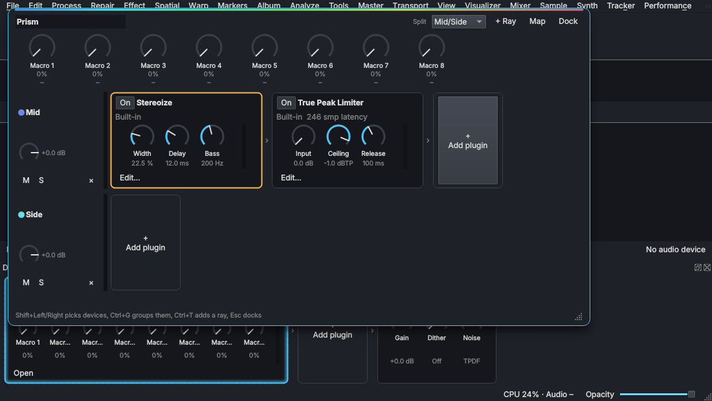

# Prisms

Status: step 1 built (2026-10-23). Owner's ask (2026-10-23): "racks for PHINYX [now PHI] ... maybe racks
could be nested in the Device Chain, but always pop out as a floating window when editing it.
When done editing it, it returns docked. We'd still have the 8 knob controls that Ableton uses.
Same key commands for grouping FX, MIDI mapping the knobs. Potentiometers in most cases." The
owner named them Prisms. The workflow follows Ableton's racks (free to copy); the names, look and
layout are PHI's own.

## What it is

A Prism is a device in the Device Chain that holds rays: rows of plugins side by side. It
divides the sound among its rays, keeps them in time with each other and joins them again,
like light through a prism. A ray can hold a Prism too, so Prisms nest.

How it divides the sound is its split:

| Split | Rays heard | What each ray hears | How they join |
| --- | --- | --- | --- |
| Parallel | all (up to 8) | everything | added together (an empty ray is the dry sound, for parallel compression) |
| Bands | up to 4 | ray 1 the lowest band, ray 2 the next... | added; the bands add back flat at every frequency |
| Mid/Side | 2 | ray 1 the mid, ray 2 the side | back to left and right |
| Left/Right | 2 | ray 1 the left, ray 2 the right | back to left and right |

Bands uses Linkwitz-Riley crossovers (24 dB/octave) with allpass compensation, so a Prism with
nothing in it gives back the same level at every frequency; the crossovers are parameters of the
Prism, so a macro can move them. Choosing Bands makes three rays (Low, Mid, High), Mid/Side and
Left/Right make two; the rays are named by the split until you rename them.

Each ray has a gain (−60 dB is off, up to +12 dB), mute and solo (solo is for listening;
renders ignore it, as with the chain's own solo). Rays whose plugins have less latency are delayed
to line up with the slowest, and a bypassed plugin is heard as a delay of its latency, so
switching it never shifts the sound. The Prism reports the slowest ray's latency to the chain.

## In the chain

A Prism is loaded like any plugin (Add plugin, Prism under Built-in), or made from plugins already
in the chain: Shift+Left/Right picks several cards, Ctrl+G groups them into a Prism (still running,
with their settings) and Ctrl+Shift+G puts a one-ray Prism's plugins back in the chain. Ctrl+G is
the editor's Gain command elsewhere; it groups only while the Device Chain has the keyboard.

Docked, a Prism is one card: its eight macros as potentiometers, and a strip with a bar per ray
lit by its level. Enter, E or Open pops it out.

## Popping out

The Prism rises out of its card as a floating panel over the window, and sinks back into the
card when you are done: Esc, Dock, or Open on the card again. Its card stays lit while it is out.
It is part of the main window rather than a window of its own, so it opens in the same place on
every desktop (Wayland does not let a program place its own windows). Drag its header to move it,
and the corner to resize it; it grows to show all its rays. It opens again where it was left, at
that size, floating over whatever is there (owner, 2026-10-25), as long as that place is still
inside the window; else it rises from its card.

Ctrl+Alt+P, or Window along its top, pops it out of the main window into a window of its own,
the way REAPER's FX windows float (owner, 2026-10-30: "I like having the edit of any effect,
process or instrument pop out as well... just like reaper"), and back over the chain again. In its
own window the desktop places and moves it (its header drags it), Ctrl+F or Super+F takes it full screen and back,
and it opens that way, at that size, until it is popped back in. Ctrl+W closes it either way and
docks the Prism; it never closes the file behind it. The Prism keeps playing whether its editor
is open or not.

Inside: the name (F2), the split and the crossovers along the top, the macros, then a row per ray
with its gain, M, S and its devices as cards, ending with Add plugin. Plugins drag between rays.
A Prism inside a Prism opens in place (Enter or Open), with the way back out at the top left; Esc
goes back out one level, and docks at the top.

Keys in the editor: Left/Right pick a device, Up/Down a ray, Shift+Left/Right several devices,
Ctrl+G groups them into a Prism inside this one and Ctrl+Shift+G ungroups one, Insert adds a
plugin, Delete removes it, B bypasses it, Enter or E opens it (its window, or the Prism),
Ctrl+Left/Right moves it along its ray, Ctrl+Up/Down to the next ray, M mutes and S solos the
ray, Ctrl+T adds a ray, Ctrl+Alt+P pops it out into its own window and back, Esc goes back out,
Ctrl+W docks it.

## Macros

Eight macros, each a parameter of the Prism (0 to 100 %), so they also appear in Edit and in the
Master Section's parameter list. A macro turns any number of parameters of the devices in its
rays, each over its own range.

- Map: press Map, turn or click a macro, then click any knob on a device in the rays. Right-click
  the macro for its mappings: Range (the parameter's value at the macro's start and end, which can
  be reversed) or Remove. A parameter follows one macro at a time. To turn something deeper in,
  map it to a macro of the inner Prism and map that macro to an outer one.
- MIDI: right-click a macro, Learn MIDI Controller, then move a knob or fader (MIDI inputs are
  opened under Sample > MIDI Inputs). The macro follows that controller on that channel from
  then on; Forget CC removes it. Learning is saved with the Prism.
- Double-click a macro's name to rename it.

Grouping or ungrouping moves the plugins, so mappings to them are dropped.

## Code

- `Source/core/PrismSplit.*`: the split and join (crossover network, mid/side, left/right) and
  the alignment delay. Plain C++, tested in `tests/CoreTests.cpp` (each split gives back its input,
  the bands add back flat from 40 Hz to 14 kHz with two to four bands).
- `Source/engine/Prism.*`: `PrismProcessor`, a built-in `AudioPluginInstance`. The Master Section
  creates its plugins (the factory), so a ray holds whatever the chain can. Edits take the Prism's
  lock on the message thread; the audio thread only tries it and passes the sound through for that
  block if it cannot get it, while renders wait for it. State is XML: rays, devices with their
  settings, macros with their mappings and controllers.
- `MasterChain`/`AudioEngine`: `ChainPath` (a slot, then a ray and device into each Prism) reaches
  any device, inside Prisms too, for its info, parameters, bypass, window and reload; `group` and
  `ungroup` move running plugins in and out of a Prism; `controller` routes MIDI CCs.
- `Source/ui/ChainRow.*`: the Prism card, Shift ranges and the grouping keys. `Source/ui/PrismEditor.*`:
  the pop-out editor.

## Instrument Prisms

Owner's ask (2026-10-30): "Another role for the prism: instrument racks that we can call
Instrument Rays that can be combined with FX in the same chain in serial mode. If the effect is
outside the prism it applies to any device or fx before or after it (like Ableton)."

An Instrument Prism is a mixer track's instrument made of rays, like Ableton's Instrument Rack.
Pick it from the instrument menu on the track's Device Chain card or strip (Instrument Prism), or
drag it from the browser's Instruments (Built-in). The track's instrument moves into its first ray
and keeps playing with its settings; a track with a Sampler, Slicer or nothing starts with a Synth.

- Each ray is a chain in series: an instrument (the Synth, PHI rāga or an instrument plugin), then
  up to eight effects of its own, each with bypass and Mix, heard only on that ray.
- A ray can hold a second instrument (owner, 2026-10-30: "up to two only at this point, running
  parallel to each other with a mix between the two ... and to allow for a split keyboard"): A and B
  play side by side into the ray's effects. Mix sets the balance: in the middle both are in full
  (layered), and each fades out towards the other end. Split at a key gives A the notes below it and
  B the notes from it up; without it both play every note the ray hears.
- The rays play together and are added, each at its gain (−60 dB is off, up to +12 dB), with mute
  and solo. A ray's effects with latency delay the other rays to match, so layers stay together.
- A ray plays only the notes in its key range (C−1 to G9, C4 is middle C) and velocity range, so
  rays split the keyboard or layer by how hard a note is hit. A note's end goes to the rays its start
  went to, even when the ranges change while it is held; controllers, pitch bend and pressure go to
  every ray.
- Effects outside the Prism, the track's inserts after its card in the Device Chain, process all
  of its rays together, as an effect outside a rack does in Ableton.

Docked, the Prism's card in the mixer's Device Chain lists its rays (instrument → effects, and the
key range when it is not the whole keyboard). Open shows its rays in a window: a row each with its
name, instrument (▾ to choose another, Edit to open it; + Instrument adds B, with its own ▾ and
Edit, and a row with the A–B Mix, double-click for the middle, and Split at), its effects (click one to open, bypass,
set its Mix, move, replace or remove it), + Effect, the key and velocity ranges (type a note name
like C3 or a number), gain, M, S, a level bar, and ↑ ↓ ✕ to move or remove it. + Add Ray (Ctrl+T)
adds a ray with a Synth; a Prism holds up to eight. Projects save the rays with their instruments'
and effects' settings.

Code: `Source/mixer/InstrumentPrism.*` (`mixer::InstrumentPrism`, a `mixer::Instrument`: the
routing by range, the rays' chains, alignment and gains; tested in `tests/CoreTests.cpp`) and
`Source/ui/MixerPrism.cpp` (the window, and saving it in a project).

## Prisms in the returns

Owner's ask (2026-11-01): "Allow for either one of the FX sends to be a Prism, but with fx only, no
instruments."

Any of the mixer's returns (Return A, Return B and any added, the strips between the tracks and the
master that the tracks' sends feed) can hold a Prism of effects in place of a single
effect. Click the ▾ on the return's effect button (or right-click it) and choose Prism (Rays of
Effects). The effect that was there moves into the Prism's first ray and keeps its settings, and
the Prism opens in a window. Clicking the effect button again opens the Prism.

- The Split along the top divides what the sends bring in among the rays, as in the Master
  Section's Prism: Parallel (every ray hears all of it, up to eight rays), Bands (up to four, with
  their crossovers beside the Split), Mid/Side or Left/Right. Choosing a split adds the rays it
  needs; a ray past what the split feeds is marked not heard.
- Each ray is a chain of up to eight effects in series: built-in, stock or any VST3, CLAP, LV2 or
  LADSPA plug-in, each with bypass and Mix. An empty ray passes its share as it came in, so a
  Parallel Prism with a reverb on one ray and nothing on the other blends wet and dry.
- Each ray has its gain (−60 dB is off, up to +12 dB), mute, solo and a level bar. Rays whose
  effects have less latency wait for the slowest, so they stay together when joined.
- No instruments: a send carries sound, not notes. The return's strip after the Prism (pan, mute,
  fader) is unchanged, and projects save the Prism with every ray's effects and settings.

Code: `Source/mixer/EffectPrism.*` (`mixer::EffectPrism`, a `mixer::Effect`: the split, the rays'
chains, alignment and gains; tested in `tests/CoreTests.cpp`) and `Source/ui/MixerFxPrism.cpp`
(the window, and saving it in a project).

## Next

- Sampler and Slicer in an Instrument Prism's rays, more than two instruments a ray, Prisms inside its rays, and its macros.
- Instrument Prisms for the patchbay's synths.
- Snapshots of the macros to recall and morph between.
- Dragging a plugin from the chain into a ray, and out again.
- Mapping a knob on the chain's own cards to a Prism's macro from outside it.
