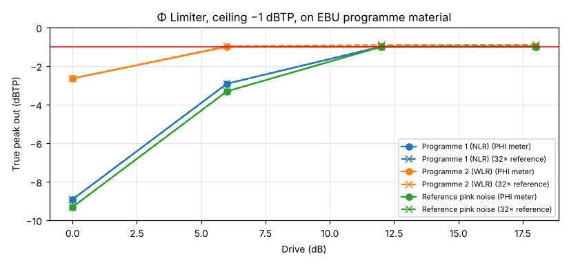
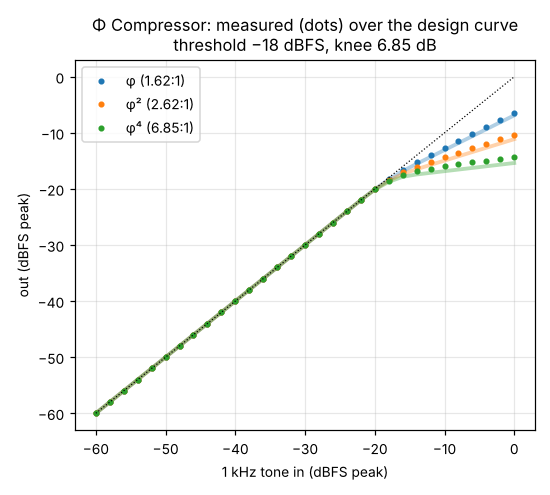
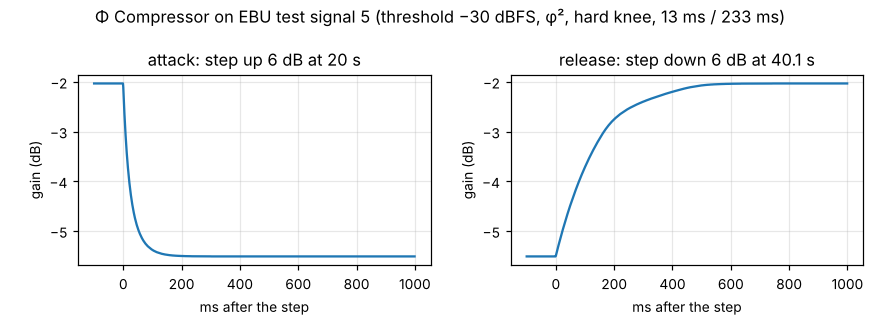
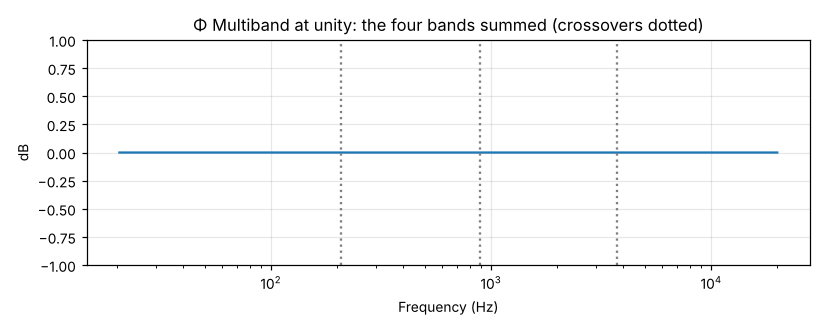
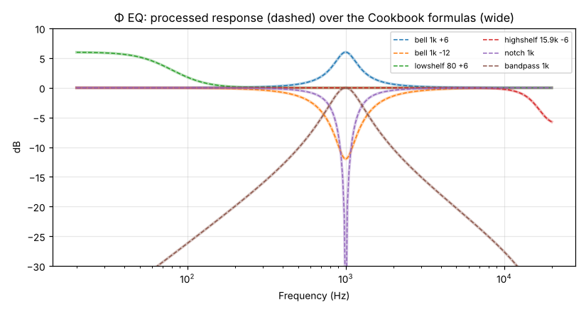

# PHI against the EBU loudness test set

Tested on 31 October 2026 with the EBU Loudness test set v05 (30 March 2016, 71 files), which
goes with EBU Tech 3341 (loudness metering, "EBU Mode"), Tech 3342 (loudness range) and
Tech 3343 (production guidelines). To run it again, see [Reproducing](#reproducing).

## What the test set can show

The EBU test signals were made to test **loudness meters**: each comes with the reading a meter
must give and how far it may be off. So this report does two things.

1. **PHI's loudness meters** (the Analysis Meters window, Loudness Statistics, the analysis report
   and Normalize, which all share the same code) are measured against every test signal for
   which Tech 3341 and 3342 give a reading.
2. **The Φ effects** (Φ Limiter, Φ Compressor, Φ Multiband and Φ EQ) are then run on EBU signals
   and on the same 1 kHz tones the EBU uses, and their output is measured with those validated
   meters. The EBU does not specify effects, so these tests check each effect against its own
   design and against the R 128 limits where one applies (the −1 dBTP ceiling). For true peak, a
   second, independent reading at 32× oversampling (a 2,048-tap Kaiser-windowed sinc) checks
   PHI's own.

## Summary

- **Loudness meters: all 110 checks pass.** That covers integrated loudness, momentary and
  short-term maxima, loudness range and true peak, each within the EBU's tolerance.
- **Two faults were found and fixed while testing:**
  - A short burst that started between PHI's 100 ms updates read its maximum momentary loudness
    up to 0.46 dB low (Tech 3341 signals 13 and 14).
  - True peak read up to 0.20 dB low on peaks exactly between samples (signals 16 and 19).
    This was still within tolerance, but it let the Φ Limiter pass its ceiling by up to 0.20 dB.
- **Φ Limiter:** PHI's meter reads −1.00 dBTP or below on every signal at every drive. The
  independent 32× reading finds peaks up to 0.10 dB above the ceiling on dense programme driven
  12 dB or more.
- **Φ Compressor:** below the threshold, the output is exact. Above it, a steady 1 kHz tone is
  reduced about 7 % less than the drawn curve (0.5 to 1.1 dB at 0 dBFS). The attack and release
  are measured below.
- **Φ Multiband at unity:** the four bands sum flat within ±0.000002 dB from 20 Hz to 20 kHz, and
  loudness and loudness range are unchanged to 0.001 LU.
- **Φ EQ:** every band type matches Robert Bristow-Johnson's Audio EQ Cookbook within 0.0014 dB,
  both in what it draws and in what it does to audio.

## 1. Loudness meters (Tech 3341, Tech 3342)

PHI reads loudness in 100 ms blocks of K-weighted power (ITU-R BS.1770), gates 400 ms blocks at
−70 LUFS and 10 LU below their mean, and takes loudness range from 3 s windows between the 10th
and 95th percentiles. The maximum momentary and short-term loudness are now taken every 10 ms.
True peak is read at 4× oversampling with a 96-tap filter.

| Test | Measures | Expected | Tolerance | PHI reads | Result |
|---|---|---|---|---|---|
| 3341 #1 | Integrated (I) | -23 | ±0.1 | -22.95 | pass |
| 3341 #2 | Integrated (I) | -33 | ±0.1 | -32.96 | pass |
| 3341 #3 | Integrated (I) | -23 | ±0.1 | -23.01 | pass |
| 3341 #4 | Integrated (I) | -23 | ±0.1 | -23.01 | pass |
| 3341 #5 | Integrated (I) | -23 | ±0.1 | -22.98 | pass |
| 3341 #6 | Integrated (I) | -23 | ±0.1 | -23.02 | pass |
| 3341 #7 | Integrated (I) | -23 | ±0.1 | -22.99 | pass |
| 3341 #8 | Integrated (I) | -23 | ±0.1 | -23.00 | pass |
| 3341 #1 | Max momentary (M) | -23 | ±0.1 | -22.95 | pass |
| 3341 #1 | Max short-term (S) | -23 | ±0.1 | -22.95 | pass |
| 3341 #2 | Max momentary (M) | -33 | ±0.1 | -32.96 | pass |
| 3341 #2 | Max short-term (S) | -33 | ±0.1 | -32.96 | pass |
| 3341 #9 | Short-term (S), max | -23 | ±0.1 | -22.99 | pass |
| 3341 #10 (20 files or segments) | Max short-term (S) | -23 | ±0.1 | +0.01 to +0.01 from expected | pass, all 20 |
| 3341 #11 (20 files or segments) | Max S | -38 … -19 | ±0.1 | +0.01 to +0.01 from expected | pass, all 20 |
| 3341 #12 | Momentary (M), max | -23 | ±0.1 | -22.96 | pass |
| 3341 #13 (20 files or segments) | Max momentary (M) | -23 | ±0.1 | +0.01 to +0.01 from expected | pass, all 20 |
| 3341 #14 (20 files or segments) | Max M | -38 … -19 | ±0.1 | +0.01 to +0.01 from expected | pass, all 20 |
| 3341 #15 | True peak (dBTP) | -6 | +0.2/−0.4 | -6.00 | pass |
| 3341 #16 | True peak (dBTP) | -6 | +0.2/−0.4 | -6.00 | pass |
| 3341 #17 | True peak (dBTP) | -6 | +0.2/−0.4 | -6.00 | pass |
| 3341 #18 | True peak (dBTP) | -6 | +0.2/−0.4 | -6.00 | pass |
| 3341 #19 | True peak (dBTP) | 3 | +0.2/−0.4 | 3.01 | pass |
| 3341 #20 | True peak (dBTP) | 0 | +0.2/−0.4 | -0.13 | pass |
| 3341 #21 | True peak (dBTP) | 0 | +0.2/−0.4 | -0.12 | pass |
| 3341 #22 | True peak (dBTP) | 0 | +0.2/−0.4 | -0.14 | pass |
| 3341 #23 | True peak (dBTP) | 0 | +0.2/−0.4 | -0.12 | pass |
| 3342 #1 | Loudness range (LRA) | 10 | ±1 | 10.00 | pass |
| 3342 #2 | Loudness range (LRA) | 5 | ±1 | 5.00 | pass |
| 3342 #3 | Loudness range (LRA) | 20 | ±1 | 20.00 | pass |
| 3342 #4 | Loudness range (LRA) | 15 | ±1 | 15.00 | pass |
| 3342 #5 | Loudness range (LRA) | 5 | ±1 | 4.97 | pass |
| 3342 #6 | Loudness range (LRA) | 15 | ±1 | 14.99 | pass |
| Tech 3343 §8.2 | Integrated (I) | -23 | ±0.1 | -22.97 | pass |

Notes:
- Tests 10 and 13 are the file-based versions, one file per segment. Tests 11 and 14 are the live
  versions, one file with twenty segments, each of which must give its own maximum.
- Before the fixes, test 13 read between −22.99 and −23.45 LUFS, failing 13 of its 20 files, and
  test 16 read −6.20 dBTP and test 19 +2.81 dBTP. Both of those were within tolerance, but they
  were the worst readings.
- Tests 20 to 23 read 0.04 to 0.06 dB lower than the independent 32× reading. A 4× meter cannot
  catch every inter-sample peak, which is why the tolerance allows −0.4 dB.

## 2. Φ Limiter

The Φ Limiter looks ahead 2.618 ms and limits to a true-peak ceiling. It was set to R 128's
production maximum of −1 dBTP with its default 89 ms release. It ran on the two programme
excerpts from the test set, the reference pink noise and the inter-sample test signals, at a drive
of 0, 6, 12 and 18 dB.

| Signal | In | Drive | Out: I (LUFS) | Out: LRA (LU) | Out TP, PHI (dBTP) | Out TP, 32× (dBTP) |
|---|---|---|---|---|---|---|
| Programme 1, narrow range (3341 #7) | −23.0 LUFS, −8.91 dBTP | +12 dB | −11.3 | 4.5 | −1.00 | −0.98 |
| | | +18 dB | −8.0 | 1.1 | −1.00 | −0.96 |
| Programme 2, wide range (3341 #8) | −23.0 LUFS, −2.64 dBTP | +6 dB | −17.1 | 14.9 | −1.00 | −0.97 |
| | | +12 dB | −12.2 | 14.0 | −1.00 | −0.91 |
| | | +18 dB | −10.1 | 9.8 | −1.00 | −0.90 |
| Reference pink noise (3343) | −23.0 LUFS, −9.31 dBTP | +12 dB | −11.2 | 0.3 | −1.00 | −0.99 |
| | | +18 dB | −9.6 | 0.2 | −1.00 | −0.99 |
| Sine at fs/4, +3 dBTP (3341 #19) | +6.3 LUFS, +3.01 dBTP | 0 to +18 dB | +2.3 | 0.0 | −1.00 | −1.00 |
| Inter-sample bursts (3341 #20 to #23) | −2.7 LUFS, about −0.1 dBTP | 0 to +18 dB | −2.7 to +2.2 | 0.0 | −1.00 | −0.94 to −0.96 |

Wherever the drive leaves the peaks below the ceiling, the limiter passes the audio unchanged:
loudness, loudness range and peaks are the same as the input.

Any BS.1770 meter, PHI's included, reads the output at or below −1.00 dBTP. A finer reading finds
up to 0.10 dB more on the wide-range programme driven hard, because a 4× detector cannot see every
peak between its points. That is within the EBU's meter tolerance. If a stricter ceiling is
wanted, the limiter could detect at 8×, or set −1.1 dBTP.

## 3. Φ Compressor

### Static curve

The test signals are 1 kHz stereo tones from −60 to 0 dBFS in 2 dB steps, like Tech 3341's
signal 1. The compressor used its default threshold of −18 dBFS and 6.85 dB knee (φ⁴ dB) at three
golden ratios. Each output was measured as RMS over the last second of three and expressed as a
sine's peak.

| Ratio | Out at −20 dBFS in (measured / design) | Out at −10 dBFS in | Out at 0 dBFS in |
|---|---|---|---|
| φ (1.62:1) | −20.04 / −20.06 | −12.68 / −13.06 | −6.39 / −6.88 |
| φ² (2.62:1) | −20.06 / −20.09 | −14.34 / −14.94 | −10.34 / −11.13 |
| φ⁴ (6.85:1) | −20.09 / −20.13 | −15.99 / −16.83 | −14.30 / −15.37 |

Below the knee, the output equals the input exactly. The knee follows the curve of Giannoulis,
Massberg and Reiss (2012) that PHI uses. Above it, a steady tone gets about 93 % of the reduction
the curve shows. The compressor detects each sample's peak: it charges at the attack rate near
the top of each cycle and lets go at the release rate in between, so it settles a little under
the peak. This is how a peak-sensing compressor with these times behaves on a tone. It does mean
the drawn curve shows slightly more reduction than a held tone gets.

### Attack and release

EBU test signal 5 steps a 1 kHz tone from −26 to −20 dBFS and back. The compressor was set to a
−30 dBFS threshold, φ² ratio, hard knee, 13 ms attack and 233 ms release. The gain was measured
every millisecond.

| | Measured: 63 % | Measured: 90 % | Design |
|---|---|---|---|
| Attack (gain −2.1 → −5.5 dB) | 26 ms | 67 ms | 13 ms time constant (63 %), 30 ms to 90 % |
| Release (gain −5.5 → −2.0 dB) | 134 ms | 309 ms | two stages, 144 ms and 377 ms mixed 1/φ and 1/φ²: 207 ms to 63 %, 557 ms to 90 % |

On a tone, the attack takes about twice its setting, because the detector only charges near the
top of each cycle. The release is faster than its design, because between peaks the detector
falls towards no reduction. Both follow from the same peak detection as the static curve.

## 4. Φ Multiband at unity

With every band's threshold far above the signal, Φ Multiband should change nothing. It splits at
209 Hz, 887 Hz and 3.76 kHz with Linkwitz-Riley crossovers and all-pass alignment.

| Signal | I in → out (LUFS) | LRA in → out (LU) |
|---|---|---|
| Programme 1 (3341 #7) | −22.986 → −22.986 | 4.97 → 4.97 |
| Programme 2 (3341 #8) | −22.998 → −22.998 | 14.99 → 14.99 |
| Reference pink noise (3343) | −22.966 → −22.966 | 0.19 → 0.19 |
| Tech 3342 #4 | −24.492 → −24.492 | 15.00 → 15.00 |
| 1 kHz sine, −20 LUFS | −19.954 → −19.954 | 0.00 → 0.00 |

The magnitude of the summed bands, from the impulse response, lies within ±0.000002 dB from
20 Hz to 20 kHz.

## 5. Φ EQ

Each band type was set on one band of the Φ EQ: a bell at 1 kHz (+6 and −12 dB, Q = φ^1.5), a low
shelf at 80 Hz (+6 dB), a high shelf at 15.9 kHz (−6 dB), a notch and a band-pass at 1 kHz. Each
was checked three ways:
- the Cookbook's formulas, computed independently from the text;
- what the Φ EQ draws;
- what it actually does to an impulse.

| Band | Drawn vs Cookbook | Processed vs Cookbook |
|---|---|---|
| Bell 1 kHz +6 dB | 0.000001 dB | 0.00001 dB |
| Bell 1 kHz −12 dB | 0.000002 dB | 0.00004 dB |
| Low shelf 80 Hz +6 dB | 0.000003 dB | 0.00014 dB |
| High shelf 15.9 kHz −6 dB | 0.0000005 dB | 0.000001 dB |
| Notch 1 kHz | 0.00002 dB | 0.0014 dB |
| Band-pass 1 kHz | 0.00002 dB | 0.0013 dB |

The largest differences are where the response falls steeply, around the notch and on the
band-pass skirts, and they are smaller than 32-bit floating point resolves there. The notch's
bottom, below −40 dB, is left out of the comparison.

## Reproducing

Download and unzip the test set from the EBU (https://tech.ebu.ch/loudness), then run

    EBU_SET=/path/to/ebu-loudness-test-setv05 tools/ebu-tests/run.sh build-ebu

This needs g++ with C++20, and Python 3 with NumPy and Matplotlib. `run.sh` builds the tests
from PHI's own sources (`Source/core/Dsp.cpp`, `PhiDynamics.cpp`, `Phi.cpp`), runs them, and
writes the tables, `conformance.json` and these graphs to the build folder. The test set is the
EBU's and may be used only for technical testing, so it is not kept in this repository.

## References

- EBU Tech 3341, "Loudness Metering: 'EBU Mode' metering to supplement EBU R 128 loudness
  normalization", version 4 (November 2023), Table 1.
- EBU Tech 3342, "Loudness Range: A measure to supplement EBU R 128 loudness normalization".
- EBU Tech 3343, "Guidelines for Production of Programmes in accordance with EBU R 128",
  section 8.2 (the reference listening signal).
- EBU Loudness test set v05 (30 March 2016).
- ITU-R BS.1770, "Algorithms to measure audio programme loudness and true-peak audio level".
- Robert Bristow-Johnson, "Cookbook formulae for audio EQ biquad filter coefficients".
- D. Giannoulis, M. Massberg and J. D. Reiss, "Digital Dynamic Range Compressor Design: A Tutorial
  and Analysis", *Journal of the AES* 60 (6), 2012.
