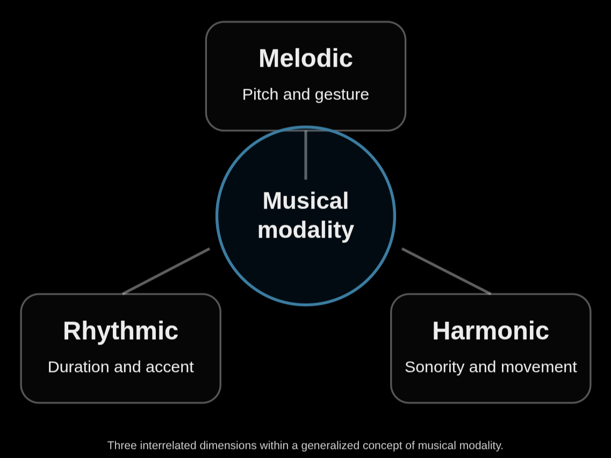

<!--
Modality: the framework behind Mode > melody, rhythm and harmony, as the owner proposes it.
It comes first under Modes, so it explains the menu before the traditions. The owner's own
text, edited only for the panel: third person and plain links. The diagram is
modality-diagram.png beside this file; an image of that name in your research folder wins.
-->

# Modes

## Mode in PHI: melody, rhythm and harmony

PHI's Mode menu has three parts, melody (with tuning), rhythm and harmony, because it follows a
generalized theory of musical modality proposed for PHI. In this theory mode no longer refers
mainly to the organization of pitches. It describes the manner in which musical relationships
are organized and realized across several dimensions. That is why the word is taken in its
broad sense of [a method or way](research:Mode).

The theory distinguishes three primary categories:

1. **Melodic mode**: the manner in which pitches, intervals, melodic gestures and phrases are
   organized and realized through time.
2. **Rhythmic mode**: the manner in which durations, accents, temporal groupings, repetitions
   and rhythmic gestures are organized and realized through time.
3. **Harmonic mode**: the manner in which simultaneous pitches, sonorities, harmonic
   relationships and their transformations are organized and realized through time.

The significant conceptual move is that modality becomes a general principle of musical
organization rather than a property exclusive to pitch systems. It is a potentially productive
framework for comparative musicology, composition and music software design.

### A general definition

> **Musical mode**: a distinguishable manner of organizing and realizing musical relationships,
> characterized by particular structural principles, hierarchies, patterns of movement,
> expressive gestures and conventions of performance within one or more dimensions of musical
> experience.

This definition lets melodic, rhythmic and harmonic modes be treated as related manifestations
of a higher-order concept. It also deliberately distinguishes mode from scale, meter, chord and
rhythmic pattern. Those can be components of a mode, but they need not make up the whole mode.

### Three dimensions of modality

| Characteristic | Melodic mode | Rhythmic mode | Harmonic mode |
| --- | --- | --- | --- |
| Primary material | Pitches and intervals | Durations and temporal events | Simultaneous pitches and sonorities |
| Hierarchy | Tonics, finals, prominent tones | Strong and weak beats, temporal anchors | Harmonic centers, stable and unstable sonorities |
| Movement | Contour, direction, melodic pathways | Pulse, grouping, rhythmic flow | Voice leading, harmonic succession |
| Characteristic gestures | Motifs, turns, ornaments | Syncopation, rhythmic cells, accents | Cadences, suspensions, harmonic gestures |
| Temporal organization | Phrasing, melodic development | Meter, cycles, proportional duration | Harmonic rhythm and rate of change |
| Performance realization | Intonation, articulation, ornament | Timing, swing, microtiming | Voicing, tuning, articulation |

The three modes need not depend on one another. A composition could keep its melodic mode while
changing its rhythmic or harmonic mode, and the same rhythmic organization might support several
melodic systems.

### Historical precedents

The three-part framework is a proposed synthesis rather than an established universal
classification, but it has antecedents.

- **Rhythmic mode** already has an explicit history. The Notre-Dame school of medieval
  polyphony used six [rhythmic modes](research:Medieval%20rhythmic%20modes%20%28ars%20antiqua%29), patterns
  of long and short durations. Mode has described temporal organization, not only pitch, for
  eight centuries. Luigi Antonio Irlandini's study "Expanded Modal Rhythm" (2017) extends
  rhythmic modality to ametric textures, polyrhythms, cross-rhythms and different kinds of
  rhythmic flow.
- **Melodic mode** has especially strong precedents in [rāga](research:Rāga),
  [maqām](research:Maqām) and other traditions in which characteristic melodic gestures and
  performance practice belong to a mode's identity.
- **Harmonic mode** is more complicated. Western theory recognizes modal harmony, but that
  usually means harmony working within an established pitch mode. Harmonic mode here is broader:
  a recognizable manner of organizing harmonic relationships in its own right, such as
  functional tonal progression, parallel chord movement, harmonic stasis, or transformations
  among sonorities (see [Harmony beyond the West](research:Harmony%20beyond%20the%20West)). Not every
  harmonic technique is a separate mode, so the theory needs criteria for telling a harmonic
  mode from a harmonic style, a procedure or a single composition.

### Mode and material

A mode is more than a list of permitted materials. It describes how those materials relate and
behave. Each mode can be described at four analytical levels, which apply the same way to all
three dimensions:

1. **Material**: what musical elements are available?
2. **Organization**: what relationships and hierarchies exist among them?
3. **Behavior**: how do those elements move, interact, develop or transform?
4. **Realization**: how are those relationships expressed through composition, improvisation and
   performance?

### A formal model

A musical configuration can be written as **M** = (*M*m, *M*r, *M*h): its melodic, rhythmic and
harmonic modes. Each component holds its own materials, organizational rules, behavioral
tendencies and performance practices, and a composition is a particular realization of these
dimensions and their interactions. This is an initial model. It still has to account for
variable combinations, ambiguity, and traditions in which the dimensions are not understood as
independent.

### Mode and form

A mode is not a musical form. Sonata form describes a large-scale organization of material,
while a melodic, rhythmic or harmonic mode may work locally, throughout a composition, or across
a whole tradition. In the same way, meter is not rhythmic mode, and a scale is not melodic mode:
a rhythmic mode can involve timing, duration, grouping, accent and gesture without conventional
meter.

### A refined definition

> **Musical modality** is the systematic organization and realization of musical relationships
> through distinguishable manners of melodic, rhythmic and harmonic behavior. Each modal
> dimension may establish characteristic materials, hierarchies, movements, gestures, temporal
> relationships and conventions of performance. These dimensions may operate independently or
> interact to produce the distinctive musical identity of a composition, an improvisation or a
> musical tradition.

The theory's strongest contribution is to make modal *behavior*, not just modal content, the
defining consideration. That separates a scale from a melodic mode, a rhythmic pattern from a
rhythmic mode, and a chord vocabulary from a harmonic mode, and it supports composing with
melodic, rhythmic and harmonic modes that are combined, transformed or developed independently,
as PHI's Mode menu lets you do.

One foundational question remains open: is a mode defined mainly by its organizational rules,
or by the recognizable musical behaviors that emerge from them? The answer could set the
direction of the whole theory.

- [Mode (music)](https://en.wikipedia.org/wiki/Mode_(music)), Wikipedia.
- [Rhythmic mode](https://en.wikipedia.org/wiki/Rhythmic_mode), Wikipedia.
- Harold S. Powers, "Mode", in *The New Grove Dictionary of Music and Musicians* (1980; revised
  2001), the comparative idea of mode this theory widens.
- Luigi Antonio Irlandini, ["Expanded Modal Rhythm"](https://periodicos.unespar.edu.br/index.php/vortex/article/view/1859),
  *Revista Vórtex* (2017).
- [Open Music Theory](https://viva.pressbooks.pub/openmusictheory/), on modes, rāga and maqām.
